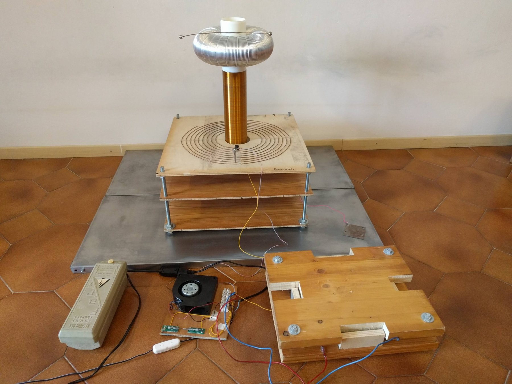
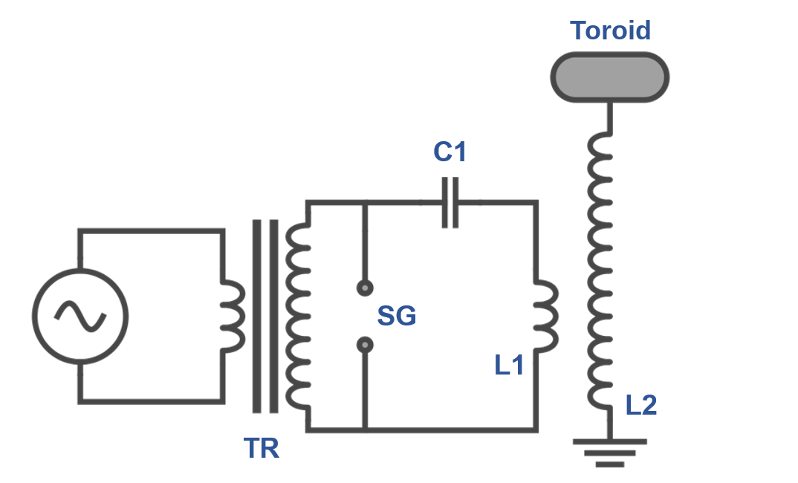
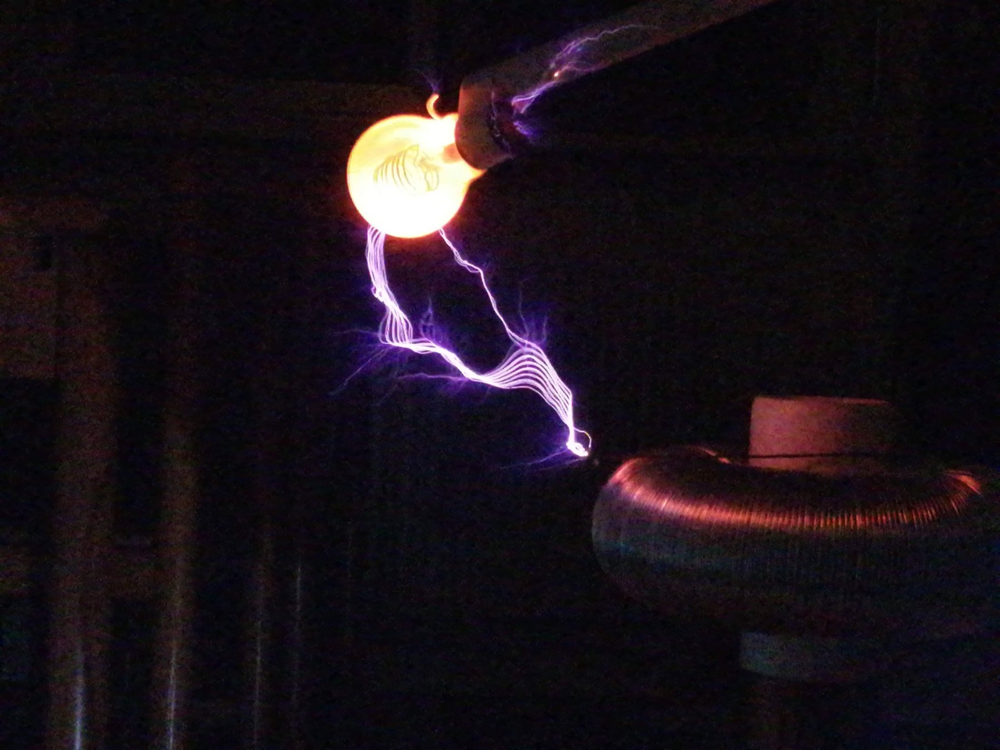
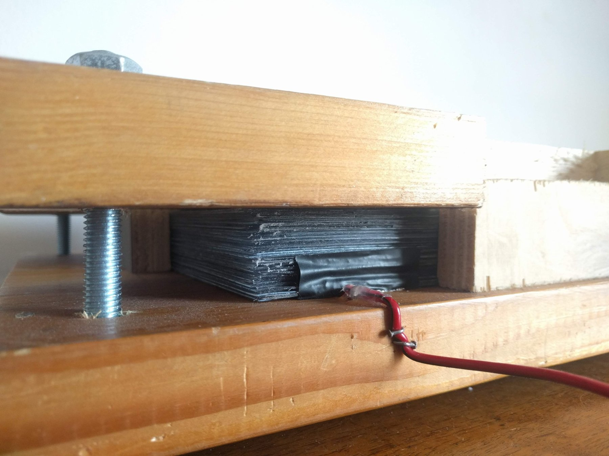
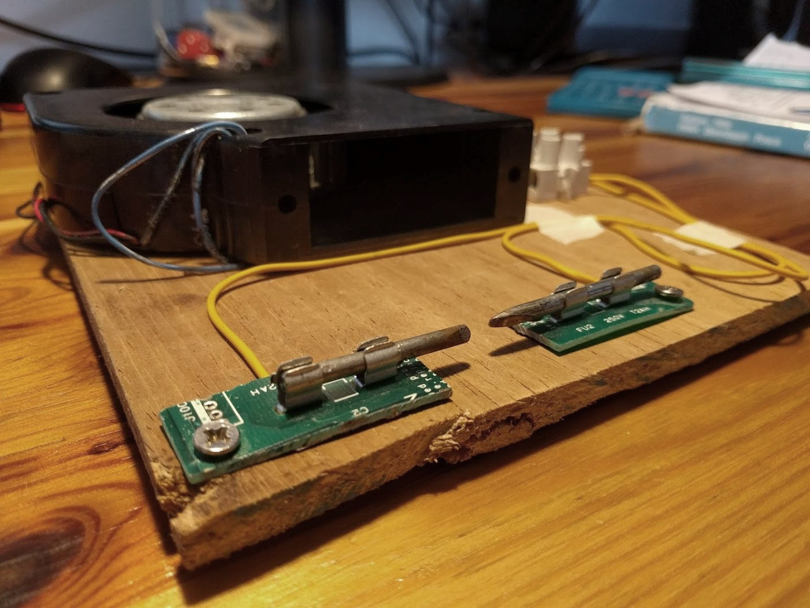
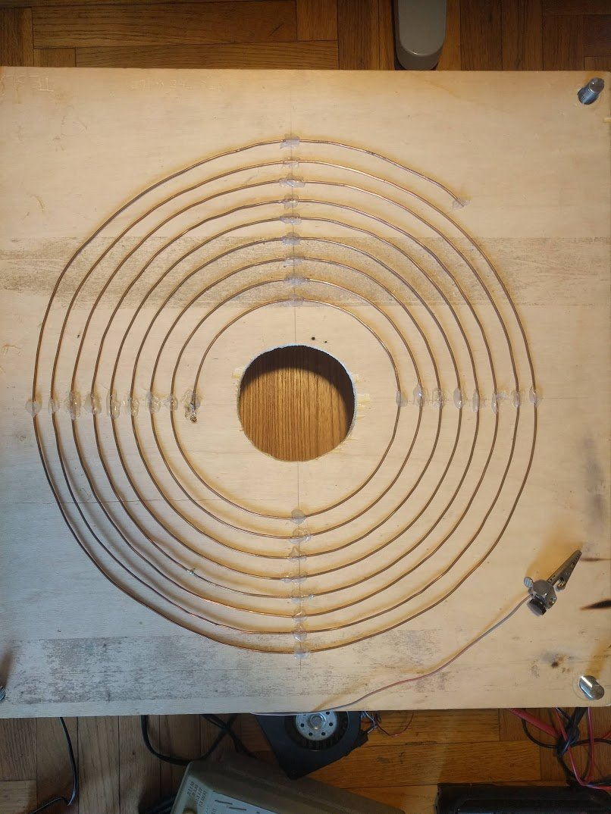

# Spark-Gap Tesla Coil (SGTC)

## Introduction

The **spark-gap Tesla coil** is the classic form of the Tesla coil, the air-core resonant transformer that Nikola Tesla presented in 1891. It is made of two loosely coupled resonant LC circuits, a primary and a secondary, tuned to the same frequency. A high-voltage transformer charges a capacitor until the voltage is high enough to break down the air in a **spark gap**. The spark closes the primary circuit, and the capacitor discharges through the primary coil as an oscillation at the resonant frequency of the circuit. The energy is transferred to the secondary, whose voltage builds up over successive cycles until high-voltage discharges leave the toroid.

---

## Desing & Technical Specifications

The coil is a spark-gap Tesla coil consisting of two magnetically coupled resonant circuits:
- **Primary Circuit:** A series circuit formed by the tank capacitor $C_1$, the spark gap $SG$, and the primary coil $L_1$.
- **Secondary Circuit:** Formed by the secondary coil $L_2$ and the toroid, grounded at its base.

---

### Circuit Design

* **HV Transformer:** The primary circuit is powered by a high voltage neon sign transformer. Choosing the right capacitance allows the transformer-capacitor RLC circuit to resonate at the `50 Hz` mains frequency, boosting the energy accumulated in the primary RLC circuit.
* **Primary Capacitor ($C_1$):** A custom-built `~20 nF` capacitor constructed from $N = 20$ plates separated by PVC sheets, split into two sections connected in series to safely handle high voltages.
* **Spark Gap ($SG$):** Formed by soldering iron tips used as electrods, spaced roughly `3–4 mm` apart. It acts as an automatic high-speed switch: once $C_1$ charges above a certain voltage (matching the breakdown threshold of the air gap), a conductive plasma spark fires to close the circuit. The cooling fan serves to quench the arc.
* **Primary Coil ($L_1$):** A flat copper spiral equipped with a movable clip to fine-tune the primary frequency.
* **Secondary Coil ($L_2$) & Toroid:** A tall solenoid topped with an aluminum toroid, that constitute the second RLC circuit. When the spark gap fires, energy oscillates between primary and secondary circuits, building up massive voltage until powerful discharges break out from the toroid into the air.

### High-Voltage Supply
* **Transformer:** Resin Block 2000 Compact, $5000\text{ V}$ / $65\text{ mA}$ neon sign transformer
* **Estimated Inductance ($L$):** $\sim 244\text{ H}$ (at $50\text{ Hz}$, with $R \approx 5.6\text{ k}\Omega$)
* **Resonant Capacitance with the Transformer:** $C = 41.4\text{ nF}$, where the calculated voltage across the capacitor peaks at about $70\text{ kV}$

### Primary Capacitor (C1)
* **Structure:** $N = 20$ metal plates separated by PVC sheets, clamped between wooden boards with threaded rods
* **Dielectric:** PVC, $\varepsilon_r = 3$, thickness $d = 0.75\text{ mm}$
* **Plate Area:** $A = 0.048\text{ m}^2$ ($22\text{ cm} \times 22\text{ cm}$ plates with a $3\text{ cm} \times 5\text{ cm}$ connection tab)
* **Layout:** two $40\text{ nF}$ sections connected in series
* **Capacitance:** $C_P = \frac{N}{2}\,\varepsilon_0\,\varepsilon_{PVC}\,\frac{A}{d} \approx 20\text{ nF}$

### Spark Gap (SG)
* **Electrode Distance:** $3\text{–}4\text{ mm}$
* **Theoretical Breakdown Voltage:** $9\text{–}12\text{ kV}$
* **Cooling:** a fan is mounted next to the gap

### Primary Coil (L1)
* **Geometry:** flat spiral; the precise number of turns is set with a clip on the coil
* **Estimated Inductance:** $L = \approx 12.9\text{ µH}$
* **Tuning:** about $6.5$ turns give a primary resonant frequency of $\approx 310\text{ kHz}$

### Secondary Coil & Toroid
* **Secondary Winding:** $1015$ turns ($35$ turns/cm), $255\text{ m}$ of wire
* **Secondary Diameter:** $8\text{ cm}$
* **Secondary Height:** $29\text{ cm}$
* **Wire Diameter:** $0.285\text{ mm}$
* **Inductance ($L$):** $19.634\text{ mH}$
* **DC Resistance:** $88\ \Omega$
* **Self-Capacitance:** $3.079\text{ pF}$
* **Toroid:** aluminium, tube diameter $9\text{ cm}$, inner diameter $8\text{ cm}$, outer diameter $26\text{ cm}$
* **Toroid Capacitance:** $10.29\text{ pF}$
* **Resonant Frequency:** $f = \frac{1}{2\pi\sqrt{L\,(C_{sec}+C_{toroid})}} \approx 310\text{ kHz}$

---

## Schematic

- **Supply (TR):** the high-voltage transformer feeds the primary circuit from the mains.
- **Primary circuit (C1, SG, L1):** the capacitor C1 charges through the transformer secondary. When the voltage reaches the breakdown voltage of the spark gap SG, the gap closes the circuit and C1 discharges through the primary coil L1 as a high-frequency oscillation.
- **Secondary circuit (L2 and toroid):** L2 is magnetically coupled to L1 and resonates at the same frequency. Its voltage builds up at the toroid, where the discharges form. The base of L2 is grounded.

---

## Photos & Videos

*Streamers from the toroid to a lamp filled with Neon gas, which lights up.*

*The home-made primary capacitor: plates clamped between wooden boards.*

*The spark gap, with a fan next to it.*

*The flat spiral primary coil.*

