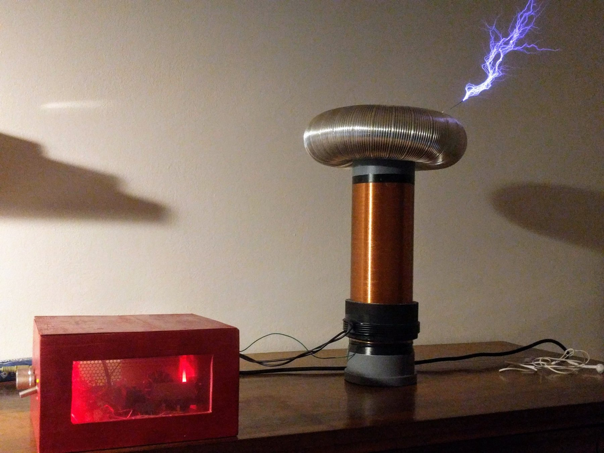
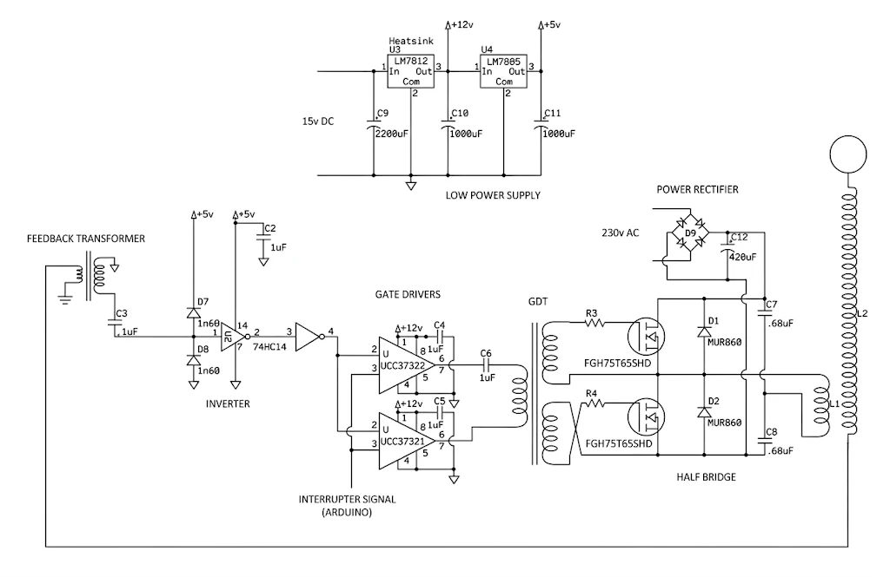
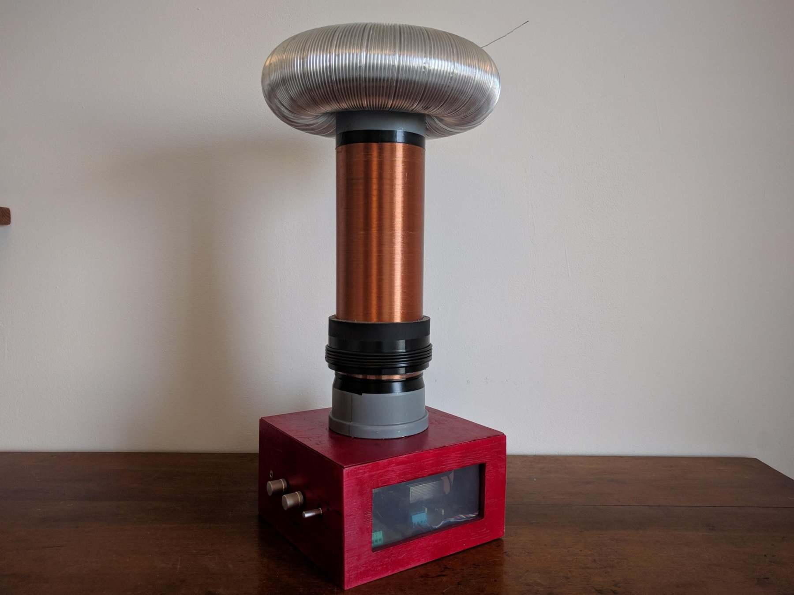
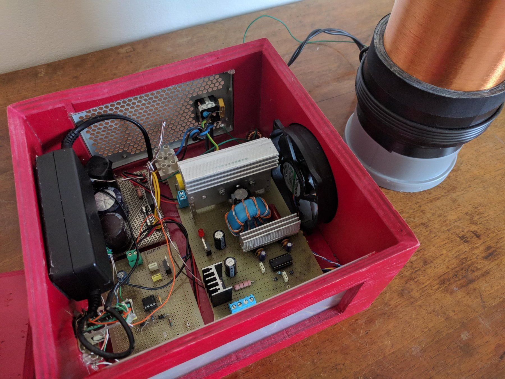

# Solid-State Tesla Coil (SSTC)

## Introduction

A **Tesla coil** is essentially a high-voltage, air-core resonant transformer invented by Nikola Tesla in the late 19th century. Unlike conventional transformers that rely on an iron core to transfer energy, a Tesla coil uses two loosely coupled resonant LC circuits, a primary and a secondary, tuned to the same resonant frequency. When energy is transferred from the primary to the secondary at this natural frequency, the voltage builds up dramatically over successive cycles, producing high-frequency, high-voltage electrical discharges into the surrounding air.

Traditionally, Tesla coils relied on a mechanical spark gap to switch high currents into the primary winding. While effective, spark gaps are noisy, inefficient, and prone to wear. A **Solid-State Tesla Coil (SSTC)** replaces this spark gap with modern semiconductor switches, such as MOSFETs or IGBTs, driven by high-speed control electronics. By switching the primary coil at its resonant frequency electronically, an SSTC achieves much higher efficiency, quieter operation, and precise control over the output arcs.

This project is a compact, table-top SSTC that I designed and built in 2020. Rather than relying on a fixed-frequency oscillator that requires manual tuning, the circuit uses a **self-oscillating driver**: a small feedback transformer at the base of the secondary coil senses the resonant current and feeds it back to the gate drivers, allowing the system to automatically lock onto and track the coil's natural resonant frequency (~150 kHz). The power stage consists of an **IGBT half-bridge** powered directly from rectified 230 V mains, built entirely on perfboard and housed inside a custom windowed enclosure with a heatsink and cooling fan. To control the power output and prevent overheating, an **Arduino-based interrupter** gates the high-frequency drive signal, which also makes it possible to modulate the sparks at audible frequencies and play simple musical tunes.
##
---

## Technical Specifications

### Secondary Coil & Topload
* **Secondary Winding:** $\sim 1500$ turns of copper wire
* **Secondary Diameter:** $11\text{ cm}$
* **Secondary Height:** $27.5\text{ cm}$
* **Wire Diameter:** $\sim 0.18\text{ mm}$
* **Estimated Inductance ($L$):** $\sim 90\text{ mH}$
* **Topload:** Aluminum toroid ($11\text{ cm}$ inner diameter, $29\text{ cm}$ outer diameter)
* **Topload Capacitance ($C$):** $\sim 12\text{ pF}$
* **Resonant Frequency:** $f = \frac{1}{2\pi\sqrt{LC}} \approx 150\text{ kHz}$

### Primary Coil
* **Primary Winding:** $5$ turns of thick, well-insulated copper wire ($0.3\text{ cm}$ diameter)
* **Primary Geometry:** $13\text{ cm}$ diameter, $2\text{ cm}$ height
* **Estimated Inductance ($L$):** $\sim 7\text{ µH}$

---

## Schematic

- **Power Rectifier & Half-Bridge:** The $230\text{V AC}$ mains voltage is rectified by a bridge diode (D9) and filtered by a $420\text{ µF}$ capacitor. The DC bus feeds a half-bridge composed of two high-power IGBTs (FGH75T65SHD) with free-wheeling diodes (MUR860). Two $0.68\text{ µF}$ film capacitors split the bus, and the primary coil sits between the half-bridge midpoint and the capacitor midpoint.
- **Gate Drivers & GDT:** Two high-speed gate drivers (UCC37321 and UCC37322) drive a Gate Drive Transformer (GDT). The GDT features tightly coupled trifilar windings on a ferrite core to minimize wire inductance, alternately switching the two IGBTs out of phase.
- **Feedback Loop:** A small current transformer at the base of the secondary coil picks up the resonant current. Clamp diodes (1n60) limit the signal, and Schmitt-trigger inverters (74HC14) convert it into a clean square wave, allowing the driver to perfectly track the natural frequency of the coil.
- **Low-Power Supply:** A $15\text{V DC}$ input is regulated down to $12\text{V}$ via an LM7812 (for the gate drivers) and $5\text{V}$ via an LM7805 (for the logic ICs).

---

## Interrupter & Music Playback

The system features an **external logic interrupter driven by an Arduino** connected to the enable pin of the gate drivers:

- **Burst Control:** The interrupter gates the high-frequency drive bursts ($\sim 150\text{ kHz}$), limiting the thermal duty cycle to protect the power stage while allowing precise control over spark intensity.
- **Plasma Speaker Mode:** By modulating the interrupter frequency within the audible range ($0\text{–}20\text{ kHz}$), the high-voltage sparks rapidly heat and cool the surrounding air, creating pressure waves that function like a plasma speaker capable of playing musical notes.

---

## Photos & Videos

